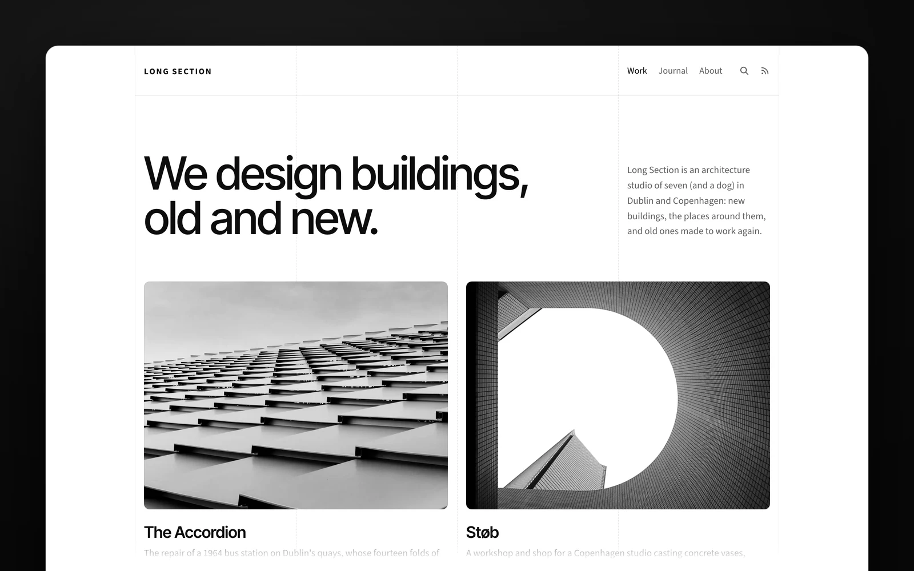
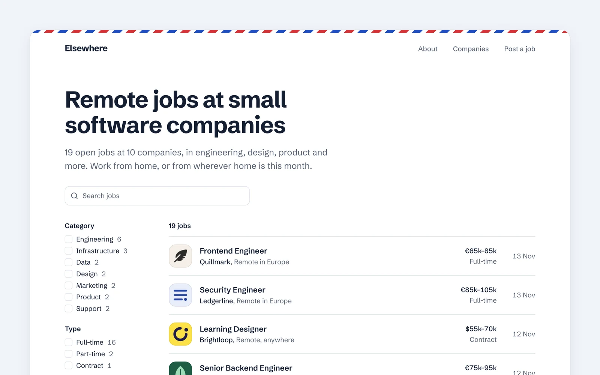

Each starter is a working site in a public repository: its content model as a [schema file](/guides/schema-as-code), a seed script for its demo content, and the code that reads it. Deploy one with the demo content to see Nohead in a real site, or point it at your own project and change it into yours. Its README sets it up: the API keys it needs, pushing the schema with the [CLI](/cli/overview), seeding the demo content and deploying.

## Portfolio (Astro)

A portfolio with a journal for Long Section, an invented architecture studio, with its people, clients, projects and posts. The site reads its content when it builds, through the [Astro adapter](/adapters/astro), and builds again when content is published.

- **What it shows:** content collections loaded from Nohead, images in every size from one upload through the [image CDN](/guides/images), search as you type with [public search](/guides/public-search), and rebuilds started by a [webhook](/guides/webhooks).
- **Step by step:** its commit history builds the site one step at a time, from a plain Astro site reading its content from files to one reading everything from Nohead.
- **Links:** [demo](https://starter-portfolio.nohead.io), [repository](https://github.com/nohead-io/starter-portfolio-astro), [deploy to Cloudflare](https://deploy.workers.cloudflare.com/?url=https://github.com/nohead-io/starter-portfolio-astro), [deploy with Vercel](https://vercel.com/new/clone?repository-url=https%3A%2F%2Fgithub.com%2Fnohead-io%2Fstarter-portfolio-astro&env=NOHEAD_API_KEY&envDescription=A%20published-only%20Nohead%20API%20key%20with%20records%3Aread%20and%20assets%3Aread%2C%20plus%20schema%3Aread%20for%20search&envLink=https%3A%2F%2Fgithub.com%2Fnohead-io%2Fstarter-portfolio-astro%23keys-and-tokens).

## Job board (Next.js)

A job board for Elsewhere, an invented board of remote jobs at small software companies: the jobs, the companies hiring and the categories they're in. Its pages are rendered on the server and cached until content changes.

- **What it shows:** search and filters with [public search](/guides/public-search), forms that save applications and posted jobs as unpublished records (a posted job goes live once someone reviews and publishes it), a [webhook](/guides/webhooks) that refreshes the cached pages when content is published, and jobs that leave the board after their closing date.
- **Links:** [demo](https://starter-jobs.nohead.io), [repository](https://github.com/nohead-io/starter-jobs-nextjs), [deploy with Vercel](https://vercel.com/new/clone?repository-url=https%3A%2F%2Fgithub.com%2Fnohead-io%2Fstarter-jobs-nextjs&env=NOHEAD_API_KEY%2CNOHEAD_SEARCH_TOKEN%2CNOHEAD_FORM_KEY&envDescription=The%20site%20key%2C%20search%20token%20and%20form%20key%20from%20your%20Nohead%20project&envLink=https%3A%2F%2Fgithub.com%2Fnohead-io%2Fstarter-jobs-nextjs%23keys).
