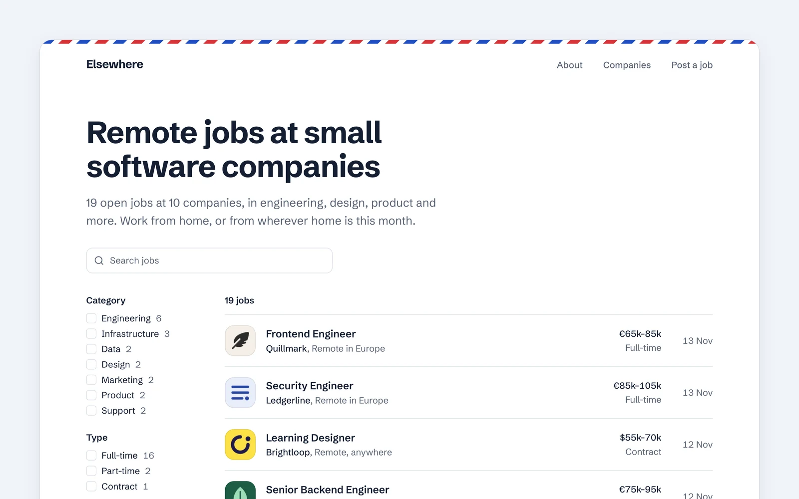

<Frame>
  
</Frame>

A job board for Elsewhere, an invented board of remote jobs at small software companies: the jobs, the companies hiring and the categories they're in. Its pages are prerendered on the server and cached until content changes.

<Columns cols={3}>
  <Card title="See the demo" icon="globe" href="https://starter-jobs.nohead.io">
    Elsewhere, live.
  </Card>
  <Card title="Repository" icon="code" href="https://github.com/nohead-io/starter-jobs-nextjs">
    The code on GitHub, under the MIT license.
  </Card>
  <Card title="Deploy with Vercel" icon="triangle" href="https://vercel.com/new/clone?repository-url=https%3A%2F%2Fgithub.com%2Fnohead-io%2Fstarter-jobs-nextjs&env=NOHEAD_API_KEY%2CNOHEAD_SEARCH_TOKEN%2CNOHEAD_FORM_KEY&envDescription=The%20site%20key%2C%20search%20token%20and%20form%20key%20from%20your%20Nohead%20project&envLink=https%3A%2F%2Fgithub.com%2Fnohead-io%2Fstarter-jobs-nextjs%23keys">
    A copy of the repository, built on Vercel.
  </Card>
</Columns>

## What it shows

- **The content model as code**: jobs, companies and categories, and the applications and postings visitors send, in [`nohead.schema.yaml`](https://github.com/nohead-io/starter-jobs-nextjs/blob/main/nohead.schema.yaml). See [Schema as code](/guides/schema-as-code).
- **One module that reads the content** for every page, with the SDK: [`lib/content.ts`](https://github.com/nohead-io/starter-jobs-nextjs/blob/main/lib/content.ts). See [Reading content](/guides/reading-content).
- **Search and filters**, each choice showing how many jobs it leaves, in [`components/job-search.tsx`](https://github.com/nohead-io/starter-jobs-nextjs/blob/main/components/job-search.tsx). See [Public search](/guides/public-search).
- **Applications saved as unpublished records**, with a key that never leaves the server, in [`app/jobs/[slug]/actions.ts`](https://github.com/nohead-io/starter-jobs-nextjs/blob/main/app/jobs/%5Bslug%5D/actions.ts). See [Writing content](/guides/writing-content).
- **Jobs posted by visitors**, unpublished until someone reviews and publishes them, in [`app/post/actions.ts`](https://github.com/nohead-io/starter-jobs-nextjs/blob/main/app/post/actions.ts). See [Publishing](/guides/publishing).
- **Cached pages refreshed when published content changes**, by a webhook: [`app/webhooks/nohead/route.ts`](https://github.com/nohead-io/starter-jobs-nextjs/blob/main/app/webhooks/nohead/route.ts). See [Webhooks](/guides/webhooks).
- **Logos resized by the image CDN**, through [`lib/image-loader.ts`](https://github.com/nohead-io/starter-jobs-nextjs/blob/main/lib/image-loader.ts). See [Images](/guides/images).
- **Jobs that leave the board** the day after their closing date, with nobody unpublishing them: the lists and search filter on the closing date, and the cache expires at midnight (UTC).

## Set it up

The repository's README sets it up: the [API keys and search token](https://github.com/nohead-io/starter-jobs-nextjs#keys) it needs, [the content model](https://github.com/nohead-io/starter-jobs-nextjs#the-content-model), [the demo content](https://github.com/nohead-io/starter-jobs-nextjs#the-demo-content), [deploying to Vercel](https://github.com/nohead-io/starter-jobs-nextjs#deploying-to-vercel) and the [webhook that refreshes the pages](https://github.com/nohead-io/starter-jobs-nextjs#refreshing-when-content-is-published). It also covers [reviewing posted jobs](https://github.com/nohead-io/starter-jobs-nextjs#reviewing-posted-jobs) and [passing applications on](https://github.com/nohead-io/starter-jobs-nextjs#passing-applications-on).
