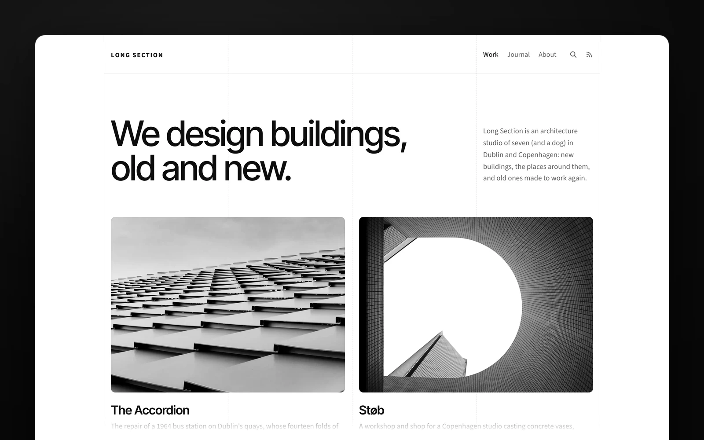

<Frame>
  
</Frame>

A portfolio with a journal for Long Section, an invented architecture studio, with its people, clients, projects and posts. The site reads its content when it builds, through the [Astro adapter](/adapters/astro), and builds again when content is published.

<Columns cols={2}>
  <Card title="See the demo" icon="globe" href="https://starter-portfolio.nohead.io">
    Long Section, live.
  </Card>
  <Card title="Repository" icon="code" href="https://github.com/nohead-io/starter-portfolio-astro">
    The code on GitHub, under the MIT license.
  </Card>
  <Card title="Deploy to Cloudflare" icon="cloud" href="https://deploy.workers.cloudflare.com/?url=https://github.com/nohead-io/starter-portfolio-astro">
    A copy of the repository on Cloudflare. Its first build fails until you add the build variables, as the README says.
  </Card>
  <Card title="Deploy with Vercel" icon="triangle" href="https://vercel.com/new/clone?repository-url=https%3A%2F%2Fgithub.com%2Fnohead-io%2Fstarter-portfolio-astro&env=NOHEAD_API_KEY&envDescription=A%20published-only%20Nohead%20API%20key%20with%20records%3Aread%20and%20assets%3Aread%2C%20plus%20schema%3Aread%20for%20search&envLink=https%3A%2F%2Fgithub.com%2Fnohead-io%2Fstarter-portfolio-astro%23keys-and-tokens">
    A copy of the repository, built on Vercel.
  </Card>
</Columns>

## What it shows

- **The content model as code**: people, categories, posts, projects and pages, in [`nohead.schema.yaml`](https://github.com/nohead-io/starter-portfolio-astro/blob/main/nohead.schema.yaml). See [Schema as code](/guides/schema-as-code).
- **Content collections loaded from Nohead** when the site builds, in [`src/content.config.ts`](https://github.com/nohead-io/starter-portfolio-astro/blob/main/src/content.config.ts). See [Astro adapter](/adapters/astro).
- **Images in every size from one upload**, made by the image CDN through the adapter's image service, set in [`astro.config.mjs`](https://github.com/nohead-io/starter-portfolio-astro/blob/main/astro.config.mjs). See [Images](/guides/images).
- **Search across the journal** as you type, in [`src/components/Search.astro`](https://github.com/nohead-io/starter-portfolio-astro/blob/main/src/components/Search.astro). See [Public search](/guides/public-search).
- **A rebuild when published content changes**, from a webhook that calls the host's deploy hook. See [Webhooks](/guides/webhooks).

## Step by step

The repository's history builds the site one commit at a time. It starts as a plain Astro site reading its content from files in `seed/`, and each commit after that moves one thing onto Nohead. Every step builds the same site, and [its commits](https://github.com/nohead-io/starter-portfolio-astro/commits/main) show what each one changes.

<Steps>
  <Step title="A portfolio reading seed files">
    The whole site, reading Markdown, YAML and images from `seed/` as content collections.
  </Step>
  <Step title="The content model as code">
    `nohead.schema.yaml` describes the content, and the CLI pushes it to a project.
  </Step>
  <Step title="A seed script for the demo content">
    `pnpm seed` uploads `seed/` to the project through the TypeScript SDK.
  </Step>
  <Step title="Nohead's Astro loader">
    The content collections load from Nohead instead of `seed/`, and the pages stay as they were.
  </Step>
  <Step title="Images from the image CDN">
    The adapter's image service writes each size into the image's URL, so the build downloads no image.
  </Step>
  <Step title="Search with public search">
    The search box sends each search straight to Nohead's public search.
  </Step>
  <Step title="Deploying to Cloudflare or Vercel">
    A deploy button and settings for each host.
  </Step>
  <Step title="Rebuilding when content is published">
    A webhook calls the host's deploy hook when published content changes, so drafts start no build.
  </Step>
</Steps>

## Set it up

The repository's README sets it up: the [API keys and search token](https://github.com/nohead-io/starter-portfolio-astro#keys-and-tokens) it needs, [pushing the schema](https://github.com/nohead-io/starter-portfolio-astro#push-the-schema), [adding the demo content](https://github.com/nohead-io/starter-portfolio-astro#add-the-demo-content-optional) and [deploying](https://github.com/nohead-io/starter-portfolio-astro#deploy).
